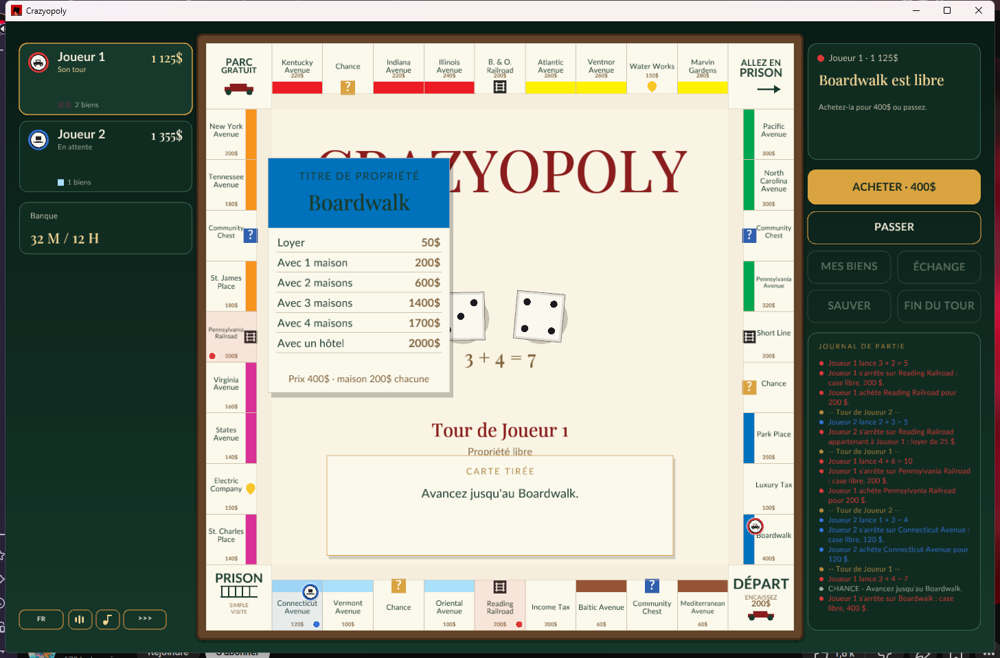
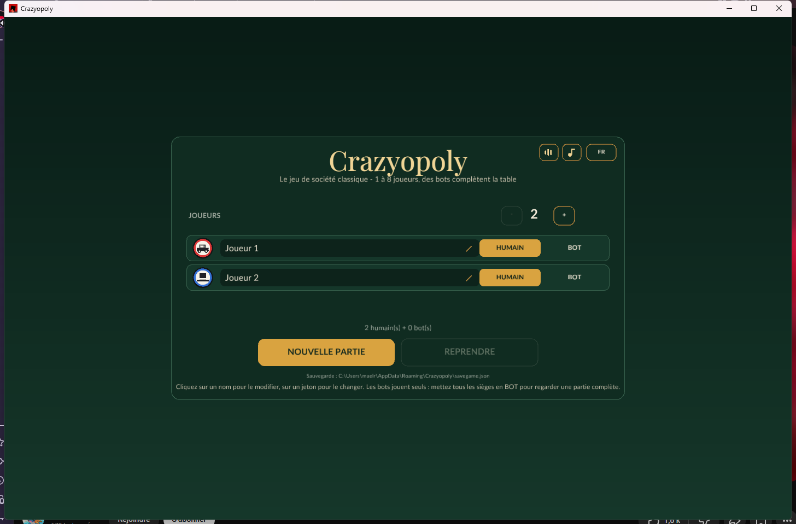
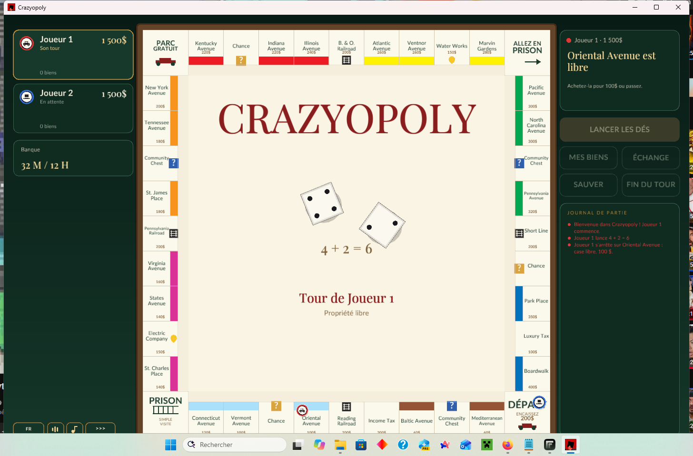
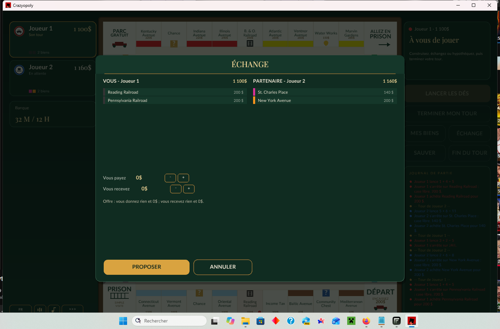
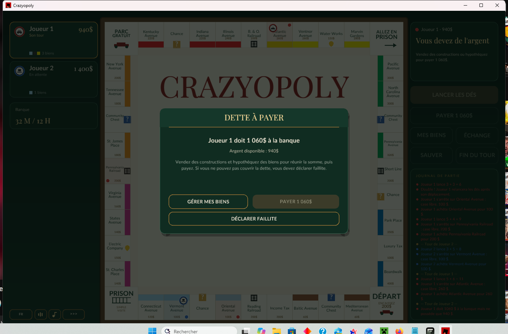
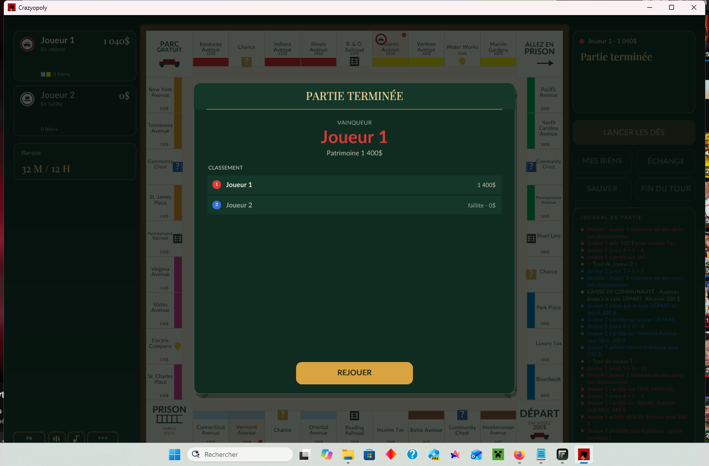

# Crazyopoly

A pixel-faithful, top-down recreation of the classic Monopoly board game in Rust,
built with [`macroquad`](https://github.com/not-fl3/macroquad). The board and the
pieces are drawn with primitives at runtime, so the whole game is a handful of
`src` files; the only assets are two bundled fonts, [Lato](https://fonts.google.com/specimen/Lato)
for body text and [Playfair Display](https://fonts.google.com/specimen/Playfair+Display)
for the titles (both SIL Open Font License), plus the soundtrack and the sound
effects, all synthesised from scratch for this game (see **Sound** below).

Base repository: <https://github.com/crazypoly/crazypoly>

A property is offered: its title deed floats over the board, the decision sits in
the right-hand column, and the log follows every move in the players' colours:



## Features

- **1 to 8 players** on one shared screen (hot-seat), with an **AI bot** toggle for
  every seat: solo against bots, a mixed table, or a game with **no human at all**
  (set every seat to BOT and watch it play itself).
- The complete **40-space official board**: all streets, colour groups, prices,
  rents, houses/hotels, four railroads and two utilities, Income Tax, Luxury Tax,
  Jail / Just Visiting, Free Parking, Go To Jail, Chance and Community Chest,
  plus the dice at the centre of the board.
- Full rules engine:
  - dice rolling, doubles (and the third-doubles jail rule), GO salary
  - property purchase, rent (including the monopoly double-rent rule),
    railroad rent by count, utilities at 4x / 10x the dice
  - **houses and hotels** with even-build/even-sell rules and the 32-house /
    12-hotel bank supply
  - **mortgaging** and lifting mortgages (with 10% interest)
  - **jail**: roll for doubles, pay the $50 fine, use a card, or serve three turns
  - **Chance and Community Chest**: all 16 classic cards in each deck
    (advance cards, nearest utility/railroad with the proper rent modifier,
    repairs, payments to/from every player, Get Out of Jail Free)
  - **auctions** when a player declines to buy
  - **trading**: properties plus cash, offered to a human or a bot, which
    evaluates the deal
  - **debt and bankruptcy**: sell buildings and mortgage lots to cover a debt,
    or declare bankruptcy; assets pass to the creditor (or the bank) and the
    last solvent player wins
- **French and English** interface, switchable at any time with the **FR / EN**
  button under the player list and on the setup screen. French is the default; street
  names stay in English to match the classic board.
- Bots buy, bid, build, raise cash and answer trade offers on their own. They also
  **start trades**: when a bot holds two lots of a colour group it offers cash for
  the third, and a human on that seat can accept or decline.
- **Save and load** a game in progress (one slot, plain JSON) plus a prebuilt
  Windows executable in `dist/`.
- **Physical dice**: every roll is a real rigid-body simulation run with the
  generic [`rapier3d`](https://rapier.rs) engine - a floor, four walls (the tray)
  and two cubes with mass, friction, restitution and a random shove and spin.
  The cubes tumble, collide, bounce and finally come to rest somewhere in the
  tray; the recorded motion is then replayed on screen. Because the board is seen
  from straight above through an orthographic camera, a die at rest shows exactly
  one face - the upper one - and that face, read back from the simulation, *is*
  the result of the throw. Nothing is drawn to force a value. Once both dice have
  stopped, they hop back to their home spots on either side of the panel centre,
  keeping the face they landed on, ready for the next roll.
- **Eight token designs** (car, top hat, dog, boot, ship, cat, plane, diamond)
  drawn with primitives - pick one for each seat on the setup screen.
- **Music and sound effects**, all original and royalty-free: a laid-back
  salon loop (electric piano, bass, brushed ride, small room reverb) under the
  whole game, plus dice tumbling, a step per space, coins, a purchase chord, a
  card swoosh, the jail clank, a hammer for houses, a low buzz for debts and a
  short fanfare when someone wins. Two icon buttons - an equaliser for the
  effects and a note for the music - turn either channel off at any time, on the
  setup screen and in the left column of the board.
- **Every space shows its own deed**: hover any tile and its title deed opens
  under the cursor - the rent table for a street, the four rates for a railroad,
  the 4x / 10x dice multipliers for a utility - with the owner (or *unowned*)
  written underneath it.
- **Your deeds on demand**: in **MES BIENS / ASSETS**, click a lot to read its
  card without leaving the window, even mid-turn.
- **Fast forward**: the `>>>` button at the bottom of the left column resolves
  the dice, the walk and every bot decision instantly, so a table of bots plays
  itself in seconds instead of minutes. Press it again to get the animations back.
- **Renamable seats**: click a name on the setup screen and type - every player,
  human or bot, can be called whatever you like.
- Animated token movement, hover tooltips on every tile, live game log.
- A **three-column layout** that fills the window: the square board in the middle,
  the players and the bank on the left, the current instruction, the action
  buttons and the game log on the right. Buying is decided right there - the
  prompt reads *"Vermont Avenue is free"*, the buttons offer **BUY** or **PASS**
  (which opens the auction), and the property's **title deed** floats over the
  board with its full rent table, so the price is visible before you commit.

## Screenshots

The setup screen - 2 to 8 seats, each one HUMAN or BOT, a token design per seat
and the FR / EN switch:



A throw in progress: the cubes tumble, bounce and land, and the upper face of
each one is the result (`3 + 6 = 9` here). Once they have stopped they hop back
to their home spots, still showing the face they landed on:



Everything the board cannot show has its own window: building, selling and
mortgaging, trading properties for cash, auctions, debts, the final ranking and
the token picker.

| Build, sell, mortgage | Read a deed you own |
| --- | --- |
|  |  |

| Trade lots for cash | Auctions |
| --- | --- |
|  |  |

| Debt and bankruptcy | The final ranking |
| --- | --- |
|  |  |

Eight token designs, drawn with primitives:


## Sound

The music and the eleven effects are **original**: `make_audio.py` renders them
from sines, filtered noise and a small Schroeder reverb, so nothing here is
borrowed and there is no licence to check. The WAVs are compiled into the
executable with `include_bytes!`, so the game still ships as a single file.

- The loop starts on the setup screen and runs through the whole game.
- The note button mutes the music, the equaliser button mutes the effects; both
  icons are struck through when their channel is off.
- No audio device (or a failed load) simply means a silent game - nothing else
  depends on it.
- To tweak the sound, edit `make_audio.py` and run `python make_audio.py`, then
  rebuild.

## Requirements

- Rust 1.75 or newer (`rustup` recommended): <https://rustup.rs>
- A desktop with OpenGL/Metal/Direct3D support. Linux additionally needs the
  usual X11/Wayland development packages that macroquad/miniquad requires
  (`libx11-dev libxi-dev libgl1-mesa-dev` on Debian/Ubuntu).
- No extra system library for the dice: the physics engine (`rapier3d`) is pure
  Rust and is compiled in with the rest of the project.

## Run

```bash
cargo run --release
```

The first build downloads `macroquad` and compiles it, which takes a minute or two.
Later launches are instant. A 1440x920 window opens; it is resizable.

To build only:

```bash
cargo build --release
```

The binary is at `target/release/crazypoly` (`crazypoly.exe` on Windows).

## Prebuilt executable

`dist/CrazyPoly.exe` is a ready-to-run Windows build: double-click it, no Rust
toolchain needed. Rebuild and refresh it with:

```bash
cargo build --release
cp target/release/crazypoly.exe dist/CrazyPoly.exe
```

## Saving and loading

- **SAVE** in the right-hand column writes the current game at the start or end of your
  turn (it is disabled while dice are moving, a card is being resolved, or an
  auction/debt dialog is open).
- On the setup screen, **CONTINUE GAME** resumes the saved game. It is disabled
  when no save exists.
- The slot lives at `%APPDATA%\CrazyPoly\savegame.json` on Windows and
  `~/.local/share/CrazyPoly/savegame.json` elsewhere. Set the `CRAZYPOLY_SAVE`
  environment variable to any file path to use a different location.
- The save holds players, cash, deeds, buildings, mortgages, the bank supply,
  turn order, dice and both card decks in their current order.

## How to play

1. On the setup screen choose **PLAYERS** (2-8 seats). Each seat can be
   **HUMAN** or **BOT**; click a name to type a new one, and click the token on
   the left to pick another design. With one human and one bot you have a solo
   game - bots fill any seat you leave to them. Set **every** seat to BOT and the
   game plays itself, which is handy to watch the AI (and the dice) at work.
2. Press **START GAME**.
3. On your turn press **ROLL DICE**. Your token walks around the board; the
   `>>>` button below the player list fast-forwards the animations (and the
   bots) whenever you want to speed things up.
4. When you land on an unowned property, choose **BUY** or **PASS** (which puts
   the lot up for auction); the deed floating over the board shows every rent.
5. Use **BUILD / MORTGAGE** to add houses and hotels, or to raise cash;
   **TRADE** opens the trade window; **END TURN** passes play on.
6. If you owe more cash than you hold, the debt dialog appears: sell buildings,
   mortgage lots, then pay - or declare bankruptcy.
7. The last solvent player wins.

Hover over any tile for its price, rent and owner. The log under the player list
records everything that happens.

## Language

French is the default. Press the **FR / EN** button under the player list, or the
one on the setup screen, to switch instantly - labels, tooltips, cards,
buttons and every log message follow the active language. All strings live in
two places: `src/i18n.rs` (`t("English", "Français")` and the `tr!` macro for
formatted messages) and the bilingual card texts in `src/cards.rs`, so adding a
language only touches those two modules.

## Project layout

```
Cargo.toml
assets/
  Lato-Regular.ttf, Lato-Bold.ttf   bundled UI fonts (SIL OFL, see OFL.txt)
  PlayfairDisplay.ttf               titles (SIL OFL, see OFL-Playfair.txt)
  audio/                            music + effects (WAV, generated, see Sound)
src/
  audio.rs   music and effects: embedded WAVs, one-shot playback, the two toggles
  main.rs    window setup, app state, frame loop
  board.rs   static board data (names, groups, prices, rent tables)
  cards.rs   bilingual Chance / Community Chest decks
  game.rs    rules engine and phase state machine
  i18n.rs    active language, `t()` and the `tr!` macro
  ai.rs      computer players, including the trade offers they make
  dice.rs           replaying the recorded throw under a vertical camera
  dice_physics.rs   the throw itself: rapier3d world, recorded poses, face read-out
  tokens.rs  the eight player token designs, drawn with primitives
  persist.rs save/load (JSON, one slot)
  ui.rs      green table look: felt, wood-framed board, gold accents, three columns
```

`make_audio.py` at the top of the repository regenerates every file in
`assets/audio/` (it needs nothing but plain Python 3).

## Rule notes

- Free Parking collects nothing (as in the official rules; no house-rule pot).
- Auction bids are limited to the bidder's cash on hand.
- When a player goes bankrupt to the bank, their lots return to the bank rather
  than being re-auctioned.
- A hotel counts as five buildings for repair cards, and sells back for 2.5x the
  house price (half of the total invested).
